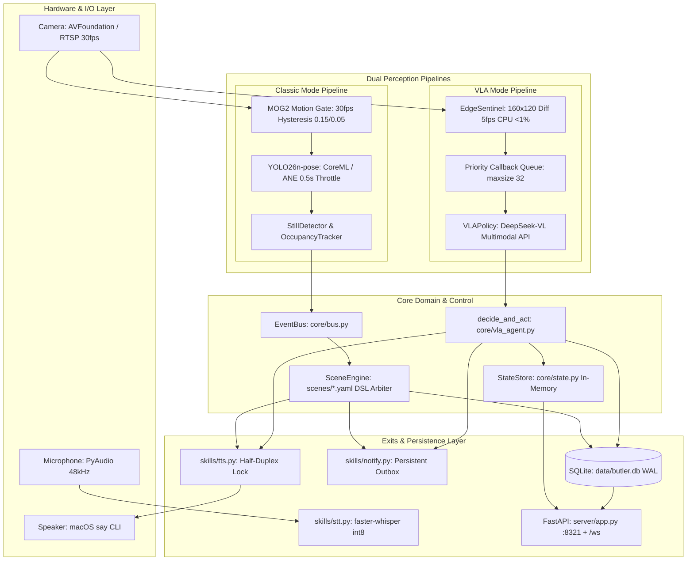

# Architecture & System Design Analysis · VMAPBL Audit
**Date**: 2026-11-04  
**Audit Protocol**: Gemini 3.8 Flash Deep Audit Protocol  
**Repository**: `/Users/liuruixuan/VMAPBL`  

---

## 1. System Topology & Data Flow Overview



---

## 2. Layering & Dependency Analysis

### 2.1 The Intended Layering Model
```
Layer 4: Presentation & Daemon: main.py, server/app.py, tools/, deploy/
Layer 3: Use Cases & Actions: actions/ (fall, medication, door, wakeup, getup, photo_ocr)
Layer 2: Capability Skills: skills/ (vision, tts, stt, notify, voice_loop, ocr)
Layer 1: Sensor Drivers: sensors/ (camera, motion, pose, sentinel, microphone, vad)
Layer 0: Core Foundation: core/ (bus, state, scene_engine, log, config, health)
```

### 2.2 Architectural Violations & Technical Debt
1. **Core Reverse Dependencies**:
   - `core/health.py:44`: Imports `skills.notify.get_webhook_urls`, reversing dependency from Core to Skills.
   - `core/vla_agent.py`: Placed under `core/`, yet imports `sensors.camera.get_current` (L488), `skills.vision` (L496), `skills.llm` (L510), `skills.tts` (L571), and `skills.notify` (L579). It acts as a top-level orchestrator masquerading as core infrastructure.
2. **Coupling between Classic and VLA**:
   - `actions/fall.py:24-26`: Classic fall action imports `is_alert_silenced` and `silence_alert` directly from `core.vla_agent`, establishing an unwanted coupling from classic actions to VLA internals.
3. **Runtime Monkey-Patching**:
   - `sensors/sentinel.py:39-77`: Injects `__getitem__`, `get`, `__contains__`, and `to_dict` onto `core.vla_agent.VLAObservation` at import time. This violates clean encapsulation and breaks static typing.

---

## 3. Dual-Pipeline Comparative Analysis: Classic vs VLA

| Dimension | Classic Mode Pipeline | VLA Mode Pipeline | Architectural Verdict |
|---|---|---|---|
| **Primary Ingestion** | 30fps MOG2 + 0.5s YOLO26n-pose | 5fps 160x120 frame diff Sentinel | Sentinel uses <1% CPU, but lacks person detection |
| **Edge Compute** | Apple Silicon M2 NPU/CoreML | Minimal edge differencing | Classic runs 100% local; VLA is cloud-dependent |
| **Token Cost** | **¥0.00 / 0 Tokens** (cloud only on demand) | **High / Unbounded** (every `motion_start` hits API) | VLA token economics are financially unsustainable for continuous 24/7 care |
| **Latency** | <50ms local deterministic decisions | 1,500ms – 3,500ms cloud network round-trip | Classic guarantees rapid reaction to falls; VLA is exposed to network jitter |
| **State Consistency** | Updates `occupancy`, `last_motion_ts`, `is_still` | Updates `last_motion_ts`, `is_still`; **leaves `occupancy` permanently False** | **VLA mode breaks dashboard and scenes relying on occupancy** |
| **Fall Safety Guarantee** | Kinematic fall curve (drop rate + torso angle) + voice cancellation | Multimodal single-frame prompt classification | Classic prevents VLM visual hallucinations (e.g. mistaking fall for yoga) |
| **Scene Engine Integration** | Fully wired (`wire_state_triggers`, `wire_event_triggers`, `wire_time_triggers`) | **Bypasses SceneEngine** (`_wire_vla` skips `state.*` and `sensor.*`) | VLA disables Scene 3 (door key), Scene 6 (get-up), Scene 7 (classic fall) |

---

## 4. State Lifecycle & Durability Deficit

```mermaid
graph LR
    subgraph Volatile_RAM [Volatile Process Memory (Lost on Reboot)]
        S1[StateStore: medication_taken]
        S2[StateStore: last_trigger cooldowns]
        S3[StateStore: occupancy, is_still]
        S4[vla_agent: _silence_until 30-min window]
        S5[wakeup: _pending date tracking]
        S6[scene_engine: _time_fired daily flags]
    end

    subgraph Durable_Storage [Durable SQLite Storage: data/butler.db]
        D1[(events table)]
        D2[(api_calls table)]
        D3[(messages table)]
        D4[(notification_outbox)]
        D5[(medications table: stock only)]
    end

    Volatile_RAM -.->|No State Write-Back| Durable_Storage
```

### 4.1 System Failure Modes on Restart
1. **Medication Loss**: Daily medication tracking (`medication_taken`) resets to `False`. If the service reboots at 10:00 AM after medication was recorded at 09:30 AM, the system assumes no medication was taken and sounds false reminders.
2. **Fall Re-Alert Surge**: The 30-minute post-alert silence window (`_silence_until`) resets to `0.0`. A reboot during an emergency causes the system to immediately re-alert and scream voice inquiries at an injured elder.
3. **Timer Double-Triggering**: Daily schedule tracking (`_time_fired`) is cleared. A reboot at 09:15 AM re-triggers the 08:30 AM morning wake-up check because `08:30:00 <= 09:15:00` and `_time_fired` is empty.

---

## 5. Single Points of Failure (SPOF) & Operational Bottlenecks

1. **Local Camera Reconnect Deadlock**:
   - `sensors/camera.py:228`: When `_cap.read()` fails on a local USB camera (`source_is_stream == False`), the thread sleeps 50ms and continues indefinitely without calling `_reconnect()` or re-opening the video capture handle.
2. **Readiness Probe Deadlock**:
   - `core/health.py:48-50`: Enforces `health["dead_count"] == 0` and `configured_channels > 0`. A single dead notification in SQLite or zero configured external webhooks locks `/readyz` in HTTP 503 permanently.
3. **TTS Lock Head-of-Line Blocking**:
   - `skills/tts.py:60`: Global FIFO `asyncio.Lock()`. An ongoing chat response or background speech locks the audio subsystem for up to 60 seconds. Emergency fall confirmations cannot preempt.
4. **Main Event Loop VACUUM Freeze**:
   - `main.py:116` & `core/log.py:351`: Executes synchronous `VACUUM INTO` on the main asyncio thread during daily maintenance, freezing all sensor processing and WebSocket connections for multiple seconds.
